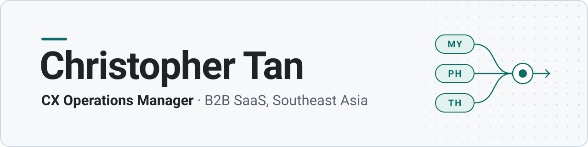

<picture>
  <source media="(prefers-color-scheme: dark)" srcset="assets/banner-dark.svg">
  <source media="(prefers-color-scheme: light)" srcset="assets/banner-light.svg">
  
</picture>

I run customer support operations across Malaysia, the Philippines and Thailand, and I build the tooling the team runs on: data pipelines, dashboards, AI agents and automations. Most of it runs on company data, so the repos are private. This page is what I build and how it works.

## What I've built

**Support data platform.** Scheduled n8n pipelines mirror the support, voice and CRM systems into Postgres, and a Node dashboard reads the mirrors: per-agent scorecards, KPI bands, drill-down to the single conversation. Half the work was the definitions. I traced metrics that were quietly wrong (every call counted twice, a second survey erasing the first rating) back to the data and fixed them at the source.
Node.js · Express · PostgreSQL · n8n · Cloudflare Tunnel + Access

**Multi-agent daily brief.** Each morning it drafts every team lead's action items: low ratings with the reason pulled from the transcript, upset customers, overdue escalations. Two LLM builders draft from different sources (chats, tickets). A "prosecutor" agent then tries to disprove each claim and hunts for what they missed. An auditor and deterministic validators gate the send, and items close when someone answers them in the thread.
Python · Claude · chat API · git-versioned state

**Ask-the-data gateway + MCP server.** Ask the mirrors a question in plain English or SQL. Queries run on a read-only role, each person has their own login, and every query is logged. The same data is exposed as an MCP server, so Claude Code can query it directly.
Node.js · PostgreSQL · MCP

**AI case tagger.** Nightly contact-reason tagging of support conversations. Keyword rules take the clear cases, an LLM settles the rest, and the hardest cases get a deeper second pass. Results are scored against hand-labelled sets.
Python · Claude · PostgreSQL

**AI-agent failure review.** Finds the conversations where the customer-facing AI agent failed, clusters them, diagnoses each cluster and routes the fix to its owner: help-centre content, product or the support team.
Python · SQL · Claude

**Playbook Q&A.** Retrieval over internal playbooks, where every answer links the source it came from. The corpus refreshes nightly from the doc wiki.
Node.js · retrieval with citations

**Coach toolkit.** Guided Claude Code workflows that non-technical team coaches run themselves, on their own access, behind a `/menu` launcher.
Claude Code · Python

## How I build

- **One source of truth.** Every number traces to a query someone else can rerun.
- **AI output gets checked, not trusted.** Adversarial agents, deterministic validators, and a human in the loop where it matters.
- **Fix the definition before the dashboard.** A wrong metric on a good-looking chart is worse than no chart.
- **Built for the people who use it.** If a coach can't run it without me, it isn't finished.

## Side projects

- **Scroll Area Capture:** a Chrome extension that captures the full length of whichever scrolling panel you pick.
- **Pocket TTS:** a local text-to-speech app that clones a voice from a short sample. Nothing leaves the machine.
- **Success Tutoring portal:** a self-hosted student and tutor portal with weekly WhatsApp report cards (n8n + WAHA, Docker).

## Toolbox

| | |
|:--|:--|
| **Languages** | JavaScript / Node.js · Python · SQL · Bash |
| **Data and automation** | PostgreSQL · n8n · Playwright · launchd |
| **AI** | Claude and Claude Code · multi-agent LLM pipelines · retrieval with citations · MCP · Whisper |
| **Infra** | Cloudflare Tunnel + Access · Tailscale · Docker · self-hosting on Apple Silicon |
| **Platforms I've integrated** | Intercom · Aircall · TalkHub · Lark · Salesforce · Shopify |

**[hello.christopher.tan@gmail.com](mailto:hello.christopher.tan@gmail.com)** · **[LinkedIn](https://www.linkedin.com/in/christopher-t-34743b1a0)**
